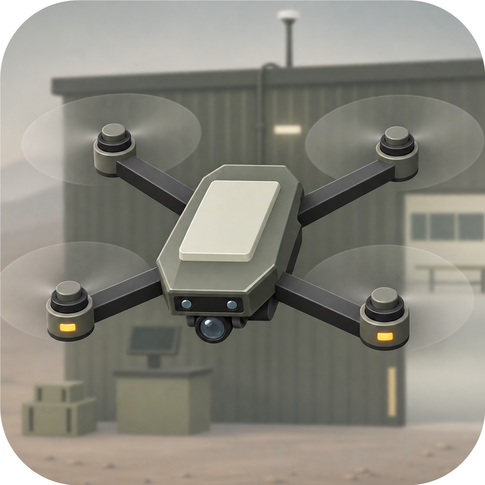
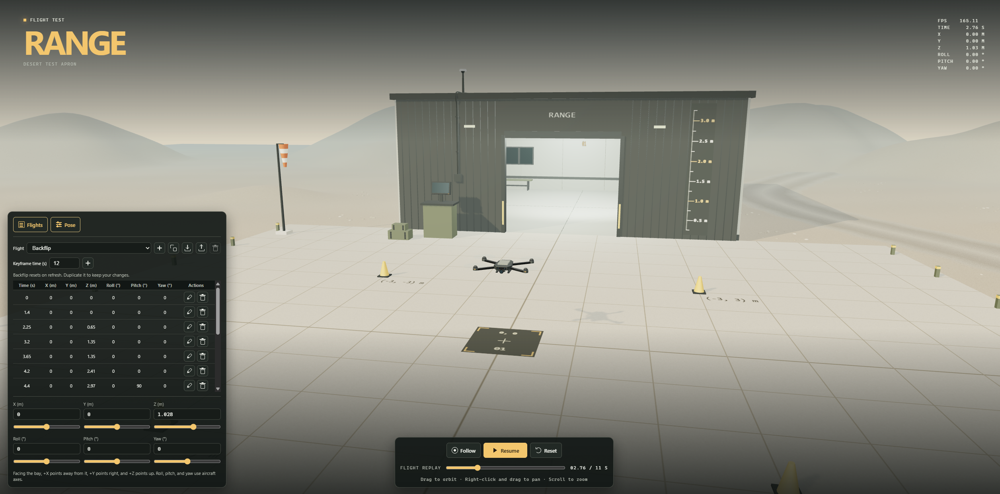

# Quad-Viz

<p align="center">
  
</p>

An interactive Three.js quadcopter visualization with a desert test range, manual pose controls, and a keyframe flight editor. Node.js and Vite handle development and builds. The visualization runs in a browser with WebGL 2.

<p align="center">
  
</p>

## Run locally

Use Node.js 22.12 or later and npm. Node.js 20.19 or later within the 20.x series also satisfies the project's Vite requirement.

```sh
npm ci
npm run dev
```

Open the local URL printed by Vite. Stop the server with Ctrl+C.

## Build or share the demo

```sh
npm run build
```

Open `dist/quad-viz.html` directly in a browser, or share that single file. It bundles the JavaScript and CSS and runs without Node.js, a web server, or an internet connection. To preview the Vite build over HTTP, run `npm run preview` after building and open the printed URL.

## Deploy with GitHub Pages

In the repository's **Settings → Pages**, select **GitHub Actions** as the source. The Pages workflow publishes the standalone build on pushes to `main`. You can also run **Deploy Quad-Viz to GitHub Pages** from the **Actions** tab. The deployment job reports the live URL.

## Camera and playback

- Drag to orbit, right-click and drag to pan, and scroll to zoom.
- Turn **Follow** on to track the quad. Turn it off to adjust the camera from the current viewpoint.
- Choose a flight in **Flights**. Click **Run flight** to play it, then **Pause** or **Resume** as needed. Drag the timeline to inspect a specific time.
- **Reset** returns the selected flight to the start and restores the default camera angle.
- The top-right readout shows renderer FPS, elapsed flight time, position, and orientation.

## Move the quad manually

Open **Pose** and drag a slider or type a value. A valid edit pauses playback and moves or rotates the quad immediately. Scrubbing or resuming playback returns control to the selected flight.

The launch pad is the position origin. When you face the bay, **+X** points away from the bay, **+Y** points right, and **+Z** points up. Position is in meters. The position sliders cover −5 to +5 m, and the number fields accept positions outside that range.

Orientation uses aircraft roll, pitch, and yaw in degrees. Roll and yaw range from −180° to +180°, and pitch ranges from −90° to +90°.

## Create or edit a flight

The **Flights** menu has icons for New, Duplicate, Import, Export, and Delete. Hover over a button to see its name.

1. Set the starting pose and choose **New** to name a flight and record its first keyframe at 0 s. To start from an existing flight, select it and choose **Duplicate**.
2. Set the next pose, enter a **Keyframe time (s)**, and click **+** to add it. Repeat for each pose. Use distinct times and add at least one keyframe after 0 s to enable playback.
3. To change an existing keyframe, click its pencil icon. Adjust the pose or timestamp, then click the check mark to save or the **×** to cancel. The trash icon on a row removes that keyframe.
4. Run or scrub the flight to check it. Position interpolates linearly between keyframes, and orientation uses quaternion interpolation along the shortest rotation. To specify a full turn, add intermediate orientation keyframes.

Custom and imported flights are saved in browser storage when available. Use **Export** to keep a portable copy. You can delete custom flights from the selector. The built-in **Backflip** restores its original keyframes on page refresh, so duplicate it to keep edits.

## Import and export CSV

Select a flight and click **Export** to download its CSV. Click **Import** to load a CSV into the selector. The imported flight takes its name from the filename.

Use this header and one row per keyframe. This example lifts the quad to 1.5 m and lands it again.

```csv
time_s,x_m,y_m,z_m,roll_deg,pitch_deg,yaw_deg
0,0,0,0,0,0,0
2,0,0,1.5,0,0,0
4,0,0,0,0,0,0
```

Use comma separators and decimal points, with a number in every field. Timestamps must strictly increase and stay between 0 and 3,600 seconds. A file can contain up to 1,000 keyframes and be up to 1 MiB.

## Source files

| File | Purpose |
| --- | --- |
| `src/main.js` | Renderer, camera, playback, and editor controls |
| `src/flights.js` | Default Backflip, keyframe interpolation, and CSV handling |
| `src/drone.js` | Quadcopter model and rotors |
| `src/facility.js` | Bay, apron, terrain, and range markings |
| `index.html` and `src/style.css` | Interface markup and styling |
| `scripts/standalone.mjs` | Packs the Vite output into one HTML file |

If the scene fails to start, check that your browser supports WebGL 2 and that hardware acceleration is enabled.
